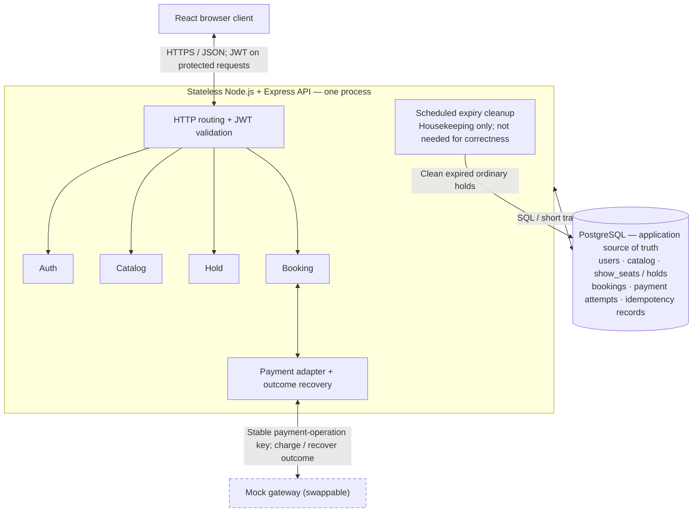

# Phase 1 — high-level design

Status: initial HLD discussion completed; hold-durability/statelessness checkpoint passed. Exact schema, routes, SQL, state transitions, authentication details, and payment recovery policy remain for their later design phases.

## Component diagram



The boxes inside the API are code modules, not independently deployed services. JWT is a user-requested authentication choice; transport/storage, expiry, signing, and logout behavior still require design. Signup and login do not require a pre-existing JWT.

Stateless means no session, hold, or booking correctness state is stored only in an API instance's memory. PostgreSQL is the application's only persistent store; mock gateway outcome replay is a required interface contract whose implementation must be specified before build. A networked gateway may have its own state in a real integration.

Adding API instances later also requires shared database access, consistent configuration/signing keys, connection-pool budgeting, and safe concurrent scheduled tasks. JWT alone is insufficient.

## Proposed hold-to-confirm sequence

Endpoint names and response codes are illustrative until API design.

```mermaid
sequenceDiagram
    actor U as Browser / user
    participant A as API modules
    participant D as PostgreSQL
    participant G as Mock gateway

    U->>A: POST /holds (showId, seatIds), JWT
    A->>D: Short transaction: validate limits; acquire all seats or rollback
    D-->>A: Hold committed / conflict
    A-->>U: 201 hold / 409 conflict

    Note over U,G: Confirmation below assumes a valid hold was acquired
    U->>A: POST /bookings/confirm (holdId), JWT, Idempotency-Key
    A->>D: Atomically claim key scoped to user and operation; validate request identity
    alt Previously completed operation
        D-->>A: Stored result for the same request
        A-->>U: Existing booking/result
    else New operation or recoverable pending operation
        A->>D: Short transaction: validate ownership/expiry; persist payment attempt and protect allocation; COMMIT
        Note over A,D: A fresh expired hold is rejected before payment. Pending recovery follows its existing operation.
        A->>G: Charge or recover using the SAME payment-operation key
        Note over A,G: No database transaction remains open during the gateway call
        alt Payment succeeded
            G-->>A: Success + stable payment reference
            A->>D: Short transaction: validate attempt; seats BOOKED + booking CONFIRMED + stored result; COMMIT
            A-->>U: 200 confirmed booking
            Note over U,D: If this response is lost, retry returns the committed booking
        else Payment definitely failed
            G-->>A: Definitive failure
            A->>D: Record failure; retain ordinary hold only until original expiry
            A-->>U: Payment failed
        else Response lost / outcome unknown
            Note over A,G: Payment might have succeeded
            A->>D: Keep durable pending/unknown operation and allocation protection
            A-->>U: 202 processing; retry/recovery uses the existing operation
        end
    end
```

## Corrections and boundaries

- A conditional multi-row UPDATE can update a subset of requested seats. The transaction must check that every distinct requested seat was acquired and rollback otherwise. Exact concurrency strategy remains open.
- The idempotency key must be claimed atomically and bound to user, operation, and request identity. A standalone read-before-write check races. Concurrent duplicate requests must not start separate payment attempts; an existing in-progress operation is observed or safely recovered.
- `PAYMENT_PENDING` is a durable business state, not a PostgreSQL row lock. Row locks end with the short transaction. Do not hold them while waiting on an external gateway.
- There are two idempotency boundaries: browser-to-API confirmation and API-to-gateway payment. Persist and reuse the mapping between them. A deliberate new payment attempt after a definitive failure differs from retrying a request whose outcome is unknown.
- A gateway timeout is not a definitive failure. Releasing inventory while a charge may have succeeded can result in a paid user losing the seat. Protect the allocation until an authoritative outcome is obtained, or a verified cancellation/refund/compensation resolves it.
- Unknown payments introduce an unresolved product policy: they may need protection beyond ordinary five-minute hold expiry. Phase 4 must define recovery ownership, triggers, deadlines, escalation, and seat-release conditions before implementation. This is not solved merely by a cleanup job.
- The expiry job cleans ordinary expired holds. Request paths enforce deadlines even if the job is late or down. The housekeeping label does not apply to payment reconciliation, which is necessary for eventual resolution of uncertain payments.
- The simple AVAILABLE → HELD → BOOKED seat model is still useful, but payment-attempt state and pending-allocation rules must accompany it. Schema names in the diagram are provisional.

## Notes to keep

- HLD includes module boundaries and external dependency boundaries, plus the principal sequence.
- One process can contain many modules: this remains a monolith.
- Stateless API instances share durable state through PostgreSQL.
- JWT identifies/authorizes a user; an idempotency key identifies an operation. They solve different problems.
- A durable seat hold is different from a database lock.
- All-or-nothing requires a transaction and validation of the full requested seat set.
- Payment failure and payment uncertainty require different handling.
- API retry safety and gateway retry safety must both be designed.
- Correctness of ordinary hold expiry must not depend on scheduler punctuality.

## Stack rationale and limitations

| Choice | Rationale | Trade-off |
| --- | --- | --- |
| React | Familiar stack; interactive seat selection, filters, and checkout UI | Browser state can be stale and cannot authorize booking changes |
| Node.js | Familiar JavaScript and primarily database/network I/O | Synchronous CPU-heavy work can block request handling |
| Express | Routing and middleware with visible request handling | Project must define module boundaries, validation, and consistent errors |
| PostgreSQL | Relational catalogue and transactional booking changes with constraints and concurrency controls | Query/index design, transaction duration, and connection budgeting require care |

One API instance and one database simplify operations but leave availability limitations: an API outage interrupts requests and a database outage interrupts authoritative booking operations. Statelessness supports adding API instances; it is not by itself high availability.

## HLD checkpoint — hold durability

User correctly explained that an API restart must not discard a committed hold: PostgreSQL stores the ownership, hold identity, and deadline; the client supplies its hold identity and a JWT identifies the user; another API instance retrieves and validates that persisted state.

Outcome: passed for the asked checkpoint. Their illustrative `show_seats` fields and SELECT are proposals, not finalized schema or production validation logic.

Clarifications:

- A hold's original deadline continues through a restart. A restarted instance does not extend it; an already expired hold is not confirmable as an ordinary active hold.
- Statelessness permits temporary request variables and non-authoritative caches. It forbids relying exclusively on one instance's memory or timers for durable hold correctness.
- Confirmation must validate state and ownership atomically with the relevant mutation; a standalone SELECT followed by an unprotected write is insufficient. Existing payment-pending recovery is distinct from validating a fresh hold.

## Sources

- [PostgreSQL explicit locking](https://www.postgresql.org/docs/current/explicit-locking.html)
- [Stripe idempotent requests](https://docs.stripe.com/api/idempotent_requests)
- [Stripe handling network errors](https://docs.stripe.com/error-low-level)
