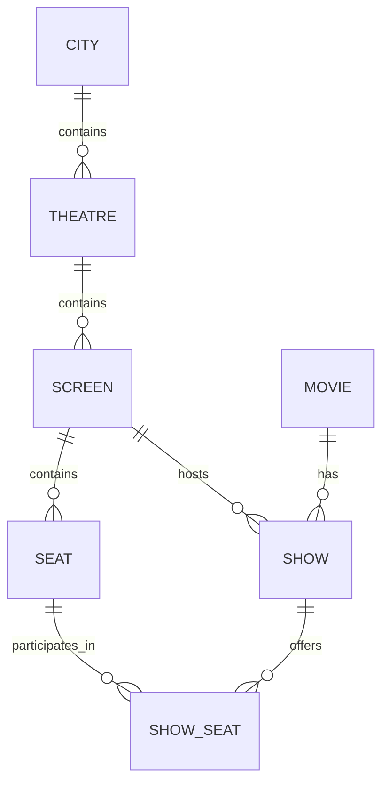
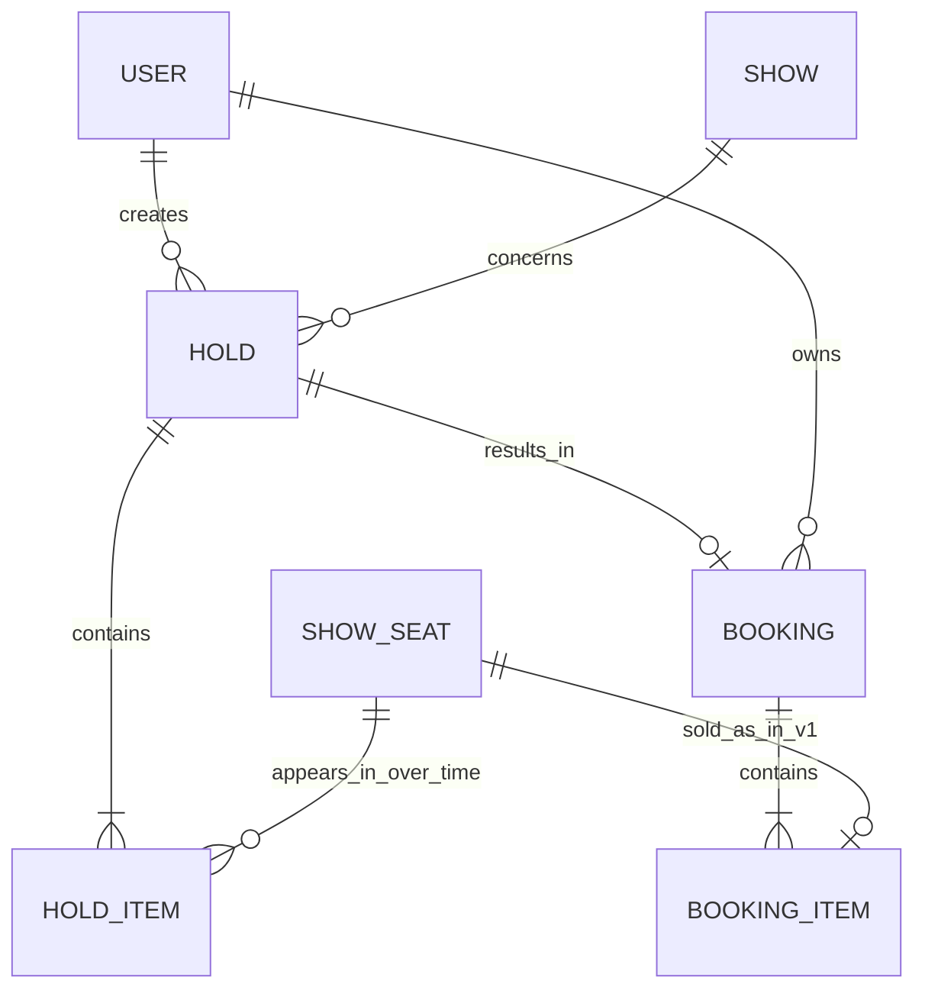

# Phase 2 — data model

Status: proposed entities and relationships under discussion. Column definitions, normalization review, constraints, and indexes are not yet finalized. No SQL or application implementation has started.

## Catalogue and inventory

- `cities`: locations for browsing.
- `theatres`: cinema venues; each belongs to a city.
- `screens`: auditoriums; each belongs to a theatre.
- `seats`: a screen's physical layout, including row, number, and seat type.
- `movies`: shared movie details such as title, duration, and language.
- `shows`: a movie scheduled in a screen at a particular time.
- `show_seats`: inventory for a physical seat in a particular show, including its allocation state and applicable price.

Example: one screen with 100 physical seats and four shows needs 100 physical-seat rows and 400 show-seat inventory rows.

Proposed provisioning: create inventory when a show is created. Benefit: straightforward availability queries and reservation targets. Cost: additional inventory rows per screening. Catalogue scale remains a planning assumption.

Required constraints to design:

- Unique `(show_id, seat_id)` inventory identity.
- A show-seat must reference a physical seat in that show's screen. Independent show/seat foreign keys alone do not enforce this.
- Screen schedule overlap and show provisioning consistency still need consideration.

## Users, holds, and bookings

Keep temporal intent separate from a completed purchase:

- `users`: authenticated owners.
- `holds`: a temporary selection of seats for one user and one show, with an original expiry deadline and lifecycle state.
- `hold_items`: membership of each selected show-seat in a hold. Retain membership after release/expiry so historical attempts remain understandable. Store a proposed server-calculated per-seat price snapshot here; the exact price-validity policy remains to be agreed.
- `bookings`: confirmed booking identity, owner, show, originating hold, confirmation time, and server-calculated total.
- `booking_items`: seats and final per-seat price snapshots belonging to a confirmed booking.

The diagram describes valid persisted aggregate records, not intermediate writes inside a transaction. Each completed hold has 1–10 distinct seats; each confirmed booking has at least one seat.

Example: one hold groups show-seats F7 and F8 for a single user and show. On successful confirmation, one booking groups those two seats. Payment failure does not create a confirmed booking. A hold can result in at most one confirmed booking.

Important distinctions:

- Historical hold membership is many-to-many: a show-seat may appear in multiple released/expired holds over time. This must not permit overlapping valid holds. Current allocation and its concurrency controls belong to the authoritative inventory design; a permanent unique constraint on `hold_items.show_seat_id` would incorrectly prevent later reuse.
- In v1, a show-seat can appear in at most one confirmed booking item. A future cancellation feature requires revisiting any uniqueness constraint that prevents reselling released inventory.
- Price snapshots preserve the quoted/confirmed price if catalogue pricing later changes. The server supplies these values; client totals are not authoritative.
- Headers group the operation (owner, show, deadline, total); item rows represent its individual seats. Avoid comma-separated seat IDs.
- Booking items must refer to the same show and seat set as the accepted originating hold; these relationships must be validated/enforced in the detailed schema and transactions.
- Payment attempts and idempotency records remain separate concepts to model next. A payment attempt is not synonymous with a confirmed booking.
- Pending or uncertain payments can protect an allocation beyond the ordinary hold deadline; the recovery policy remains required Phase 4 work. Historical membership itself does not confer current ownership.

## Notes to keep

- Movie is content; show is one scheduled screening.
- Seat is physical; show-seat is per-screening inventory.
- Hold is temporary intent; booking is confirmed outcome.
- Header/item structure represents a multi-seat operation with one parent and multiple item records.
- A seat may have many historical holds but only one valid current allocation.
- Preserve quoted and final prices rather than reconstructing old purchases from mutable catalogue prices.
- Exact table count follows requirements; earlier prototype estimates are not a design constraint.
