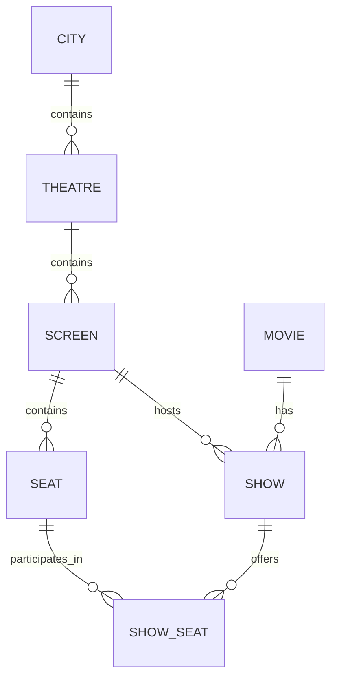
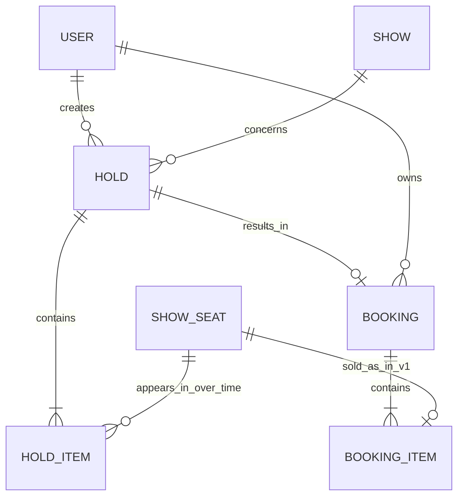

# Phase 2 — data model

Status: proposed entities and relationships under discussion. Column definitions, normalization review, constraints, and indexes are not yet finalized. No SQL or application implementation has started.

## Catalogue and inventory



- `cities`: locations for browsing.
- `theatres`: cinema venues; each belongs to a city.
- `screens`: auditoriums; each belongs to a theatre.
- `seats`: a screen's physical layout, including row, number, and seat type.
- `movies`: shared movie details such as title, duration, and language.
- `shows`: a movie scheduled in a screen at a particular time.
- `show_seats`: inventory for a physical seat in a particular show, including its allocation state and applicable price.

Example: one screen with 100 physical seats and four shows needs 100 physical-seat rows and 400 show-seat inventory rows.

Proposed provisioning: create inventory when a show is created. Benefit: straightforward availability queries and reservation targets. Cost: additional inventory rows per screening. Catalogue scale remains a planning assumption.

Required constraints to design:

- Unique `(show_id, seat_id)` inventory identity.
- A show-seat must reference a physical seat in that show's screen. Independent show/seat foreign keys alone do not enforce this.
- Screen schedule overlap and show provisioning consistency still need consideration.

## Users, holds, and bookings

Keep temporal intent separate from a completed purchase:

- `users`: authenticated owners.
- `holds`: a temporary selection of seats for one user and one show, with an original expiry deadline and lifecycle state.
- `hold_items`: membership of each selected show-seat in a hold. Retain membership after release/expiry so historical attempts remain understandable. Store a proposed server-calculated per-seat price snapshot here; the exact price-validity policy remains to be agreed.
- `bookings`: confirmed booking identity, owner, show, originating hold, confirmation time, and server-calculated total.
- `booking_items`: seats and final per-seat price snapshots belonging to a confirmed booking.



The diagram describes valid persisted aggregate records, not intermediate writes inside a transaction. Each completed hold has 1–10 distinct seats; each confirmed booking has at least one seat.

Example: one hold groups show-seats F7 and F8 for a single user and show. On successful confirmation, one booking groups those two seats. Payment failure does not create a confirmed booking. A hold can result in at most one confirmed booking.

Important distinctions:

- Historical hold membership is many-to-many: a show-seat may appear in multiple released/expired holds over time. This must not permit overlapping valid holds. Current allocation and its concurrency controls belong to the authoritative inventory design; a permanent unique constraint on `hold_items.show_seat_id` would incorrectly prevent later reuse.
- In v1, a show-seat can appear in at most one confirmed booking item. A future cancellation feature requires revisiting any uniqueness constraint that prevents reselling released inventory.
- Price snapshots preserve the quoted/confirmed price if catalogue pricing later changes. The server supplies these values; client totals are not authoritative.
- Headers group the operation (owner, show, deadline, total); item rows represent its individual seats. Avoid comma-separated seat IDs.
- Booking items must refer to the same show and seat set as the accepted originating hold; these relationships must be validated/enforced in the detailed schema and transactions.
- Payment attempts and idempotency records remain separate concepts to model next. A payment attempt is not synonymous with a confirmed booking.
- Pending or uncertain payments can protect an allocation beyond the ordinary hold deadline; the recovery policy remains required Phase 4 work. Historical membership itself does not confer current ownership.

## Notes to keep

- Movie is content; show is one scheduled screening.
- Seat is physical; show-seat is per-screening inventory.
- Hold is temporary intent; booking is confirmed outcome.
- Header/item structure represents a multi-seat operation with one parent and multiple item records.
- A seat may have many historical holds but only one valid current allocation.
- Preserve quoted and final prices rather than reconstructing old purchases from mutable catalogue prices.
- Exact table count follows requirements; earlier prototype estimates are not a design constraint.

## Payment attempts and request idempotency

Proposed records:

- `payment_attempts`: identity, hold, server-calculated amount, currency, status, stable gateway operation key, and gateway reference. Candidate states: PENDING, SUCCEEDED, FAILED, UNKNOWN.
- `idempotency_records`: authenticated user, operation, client key, request fingerprint, processing state, and attempt/result reference. Unique `(user_id, operation, key)`; claiming and linking the operation must be atomic.

One hold may have several sequential payment attempts after definitive failures, while each confirmation operation maps to one associated attempt. A successful attempt can produce at most one confirmed booking. Concurrent different-key requests for the same hold must not start competing payment attempts.

Same key and same meaningful request recover the existing result or processing state. Same key with a different request is a conflict. A completed failure replays for that key; an intentional retry after definitive failure uses a new key, subject to the original hold deadline. Unknown outcomes recover the existing attempt and gateway key rather than creating a new charge.

Example: confirmation key K1 → attempt P1 → gateway key G1 → booking B1. If the API response is lost after B1 commits, K1 returns B1. If the gateway response is lost, P1/G1 must first be recovered. Gateway key mapping is persisted before the external call.

Payment success and confirmed booking remain distinct facts. Exact state transitions, request-fingerprint fields, retention, response replay, and safe recovery ownership are later-phase work.

## Working schema conventions

These are proposed design defaults, not implemented migrations:

- UUID entity IDs; UUID values are identifiers, not authorization mechanisms.
- Required business fields are NOT NULL unless explicitly optional.
- Event/deadline timestamps use TIMESTAMPTZ. Catalogue city timezone uses an IANA name; initial Indian fixtures use Asia/Kolkata. A city-local browsing date is converted to timestamp range boundaries rather than assumed to be a UTC date.
- Monetary values use integer minor units. For INR, ₹250 is stored as 25,000 paise. Initial currency is INR; limits and arithmetic validation still apply.
- Positive quantities and nonnegative prices have CHECK constraints, in addition to NOT NULL.
- Preserve booking history: do not choose cascading catalogue deletion rules that erase purchased records. Final deletion policy is pending.

## Catalogue columns and constraints

| Table | Proposed columns, besides UUID primary key | Main constraints |
| --- | --- | --- |
| cities | name TEXT, region TEXT, country_code CHAR(2), timezone_name TEXT | Required fields; city name alone is not globally unique |
| theatres | city_id UUID, name TEXT, address TEXT | FK city_id → cities.id |
| screens | theatre_id UUID, name TEXT | FK theatre_id → theatres.id; UNIQUE(theatre_id, name) |
| seats | screen_id UUID, row_label TEXT, seat_number INTEGER, seat_type TEXT | FK screen_id → screens.id; UNIQUE(screen_id, row_label, seat_number); seat_number > 0; allowed seat types |
| movies | title TEXT, duration_minutes INTEGER, language TEXT | duration_minutes > 0; title alone is not unique |
| shows | movie_id UUID, screen_id UUID, starts_at TIMESTAMPTZ, ends_at TIMESTAMPTZ | Movie/screen FKs; ends_at > starts_at |
| show_seats | show_id UUID, seat_id UUID, screen_id UUID, price_minor INTEGER, currency CHAR(3), allocation state and references to be detailed next | UNIQUE(show_id, seat_id); price_minor >= 0; initial currency INR; same-screen integrity as below |

All listed business fields are required; allocation references will have explicit nullable rules in the transactional schema. Creation/update audit timestamps will be specified where needed; they are omitted from this teaching table.

### Enforce seat/show screen compatibility

Proposed controlled duplication: retain `screen_id` in `show_seats` to enforce both relationships using composite foreign keys:

```text
shows:      UNIQUE(id, screen_id)
seats:      UNIQUE(id, screen_id)
show_seats: FOREIGN KEY(show_id, screen_id) REFERENCES shows(id, screen_id)
show_seats: FOREIGN KEY(seat_id, screen_id) REFERENCES seats(id, screen_id)
```

The referenced unique constraints are required even though id alone is already unique. This spends redundant columns/index entries to make the same-screen rule declarative. The final normalization/index review should acknowledge this trade-off. Both composite-key columns must be NOT NULL so null values cannot bypass matching.

A CHECK cannot perform the cross-table screen lookup. Use foreign keys for that relationship; row-level CHECK rules cover things such as nonnegative prices and ends_at > starts_at.

Unresolved: preventing overlapping show schedules in one screen, transactionally provisioning complete inventory, selected seat-type vocabulary, and the hold/booking allocation columns. No prototype table-count limit overrides these requirements.

### Notes to keep — columns and constraints

- Primary key identifies a row; foreign key connects it to a valid related row.
- UNIQUE can apply to a combination, such as a seat label within one screen.
- CHECK constrains values in the row; NOT NULL must also be specified for mandatory values.
- Composite foreign keys can enforce compatibility between related entities.
- Integer minor units avoid binary floating-point rounding in monetary arithmetic.
- TIMESTAMPTZ represents an instant; retain the relevant locality's timezone separately for city/date browsing.

Source: [PostgreSQL constraints](https://www.postgresql.org/docs/current/ddl-constraints.html).

## Transactional columns — working proposal

Entity IDs and references use UUID. Amounts are INTEGER minor units; timestamps are TIMESTAMPTZ. Listed fields are required unless marked nullable. Creation/update audit timestamps are recorded where relevant and omitted from some rows for readability. State fields use TEXT with explicit CHECK lists in the working design; application enums can mirror these values later.

| Table | Proposed columns beyond its primary identity | Direct constraints |
| --- | --- | --- |
| users | id, email_normalized TEXT, password_hash TEXT, created_at | PK(id); UNIQUE(email_normalized); never store the plaintext password |
| holds | id, user_id, show_id, status TEXT, seat_count SMALLINT, total_minor INTEGER, currency CHAR(3), created_at, expires_at, updated_at | User/show FKs; seat_count BETWEEN 1 AND 10; total_minor >= 0; currency INR; expires_at > created_at; allowed statuses |
| hold_items | hold_id, show_seat_id, quoted_price_minor INTEGER | Composite PK(hold_id, show_seat_id); hold/inventory FKs; quoted_price_minor >= 0 |
| payment_attempts | id, hold_id, amount_minor INTEGER, currency CHAR(3), status TEXT, gateway_key TEXT, gateway_reference TEXT nullable, created_at, updated_at | Hold FK; UNIQUE(gateway_key); amount_minor >= 0; currency INR; allowed states; success requires a gateway reference |
| bookings | id, hold_id, user_id, show_id, payment_attempt_id, status TEXT, total_minor INTEGER, currency CHAR(3), confirmed_at | Relevant FKs; UNIQUE(hold_id); UNIQUE(payment_attempt_id); nonnegative total; initial status CONFIRMED; currency INR |
| booking_items | booking_id, show_seat_id, paid_price_minor INTEGER | Composite PK(booking_id, show_seat_id); parent/inventory FKs; UNIQUE(show_seat_id) for v1; paid_price_minor >= 0 |
| idempotency_records | id, user_id, operation TEXT, key TEXT, request_hash TEXT, status TEXT, payment_attempt_id nullable, response_status SMALLINT nullable, response_body JSONB nullable, created_at, updated_at | User/attempt FKs; UNIQUE(user_id, operation, key); status PROCESSING or COMPLETED; completed operations require a persisted terminal response |

Email normalization policy and password-hashing implementation remain security/API design work. A normalized email is the uniqueness target; UUID secrecy is not access control. Idempotency claim, attempt creation, and linking are coordinated transactionally before an external call; nullable attempt/result fields account for processing and operations rejected before payment begins. Lease/recovery ownership and retention will be specified later.

### Hold lifecycle and live-hold uniqueness

Working hold statuses: HELD, PAYMENT_PENDING, CONFIRMED, RELEASED, EXPIRED.

Proposed database enforcement for one live hold per user and show:

```text
UNIQUE(user_id, show_id) WHERE status IN ('HELD', 'PAYMENT_PENDING')
```

This is a partial unique index, not ordinary uniqueness over all historical holds. It includes PAYMENT_PENDING because uncertain payments still protect inventory. Historical released, expired, and confirmed holds remain queryable.

Time passing alone does not update a row or remove it from this index. The request path must atomically retire an expired ordinary HELD record before inserting its replacement. It must never retire a PAYMENT_PENDING hold solely because its original five-minute deadline passed. Cleanup remains housekeeping; requests perform required expiry transitions themselves. Do not use `expires_at > now()` as the index predicate.

Payment definitely failing returns its hold to HELD if the original deadline is still valid, otherwise it expires and releases ordinary inventory. Failure must not extend the original deadline. Releasing or replacing pending-payment allocations requires the later recovery policy.

### Payment attempt exclusivity

Working payment statuses: PENDING, SUCCEEDED, FAILED, UNKNOWN.

Proposed partial unique index:

```text
UNIQUE(hold_id) WHERE status IN ('PENDING', 'UNKNOWN', 'SUCCEEDED')
```

This permits sequential new attempts after definitive failures, prevents competing active attempts, and preserves exclusivity after payment succeeds even if booking finalization has not yet completed. Retry/recovery of an existing attempt does not create another row. The hold/attempt transaction must establish exclusivity before invoking the gateway; a database error after charging is not a strategy for avoiding duplicate charges.

### Current show-seat allocation

Add these fields to `show_seats`:

- `status`: AVAILABLE, HELD, or BOOKED.
- `active_hold_id`: nullable FK to holds.
- `booking_id`: nullable FK to bookings.

Row-level CHECK rules:

| State | active_hold_id | booking_id |
| --- | --- | --- |
| AVAILABLE | NULL | NULL |
| HELD | NOT NULL | NULL |
| BOOKED | NULL | NOT NULL |

Hold deadlines remain on holds; do not duplicate the authoritative expiry on every inventory row. A seat still labelled HELD can be logically expired through its ordinary hold's deadline and reclaimed transactionally. When the parent hold is PAYMENT_PENDING, its original deadline alone does not authorize reclaiming it.

Same-show, same-owner, allocation/membership compatibility, and booking/payment-attempt compatibility require composite references where appropriate and transactional validation. Individual FKs and the row-state CHECK alone do not prove those relationships. Final composite-key layout and write ordering remain for the normalization/schema review; no DDL has yet been generated.

### Direct constraints versus transaction invariants

Database-declared constraints provide the listed uniqueness, existence, and row-shape rules. The application transaction must additionally validate:

- Every selected seat belongs to the hold's show.
- The distinct hold-item count matches the declared 1–10 seat_count; a CHECK on the header alone cannot count item rows.
- All requested seats are acquired or none are acquired.
- Price snapshots sum to the stored total and match the server-approved quote/currency.
- Confirmation consumes exactly the accepted hold seat set, belongs to its owner, and uses a successful payment attempt for that hold and amount.
- State transitions respect deadlines and uncertain-payment protection.

These are not implied by table names or FKs. The final algorithm and tests must establish them; stronger declarative cross-table enforcement will be specified where practical during the review.

### Notes to keep — transactional schema

- Hold items preserve temporary-selection history; booking items preserve purchased-seat history and prices.
- UNIQUE(show_seat_id) on booking_items enforces the no-double-confirmed-booking rule for v1. Cancellation/resale would require revisiting it.
- UNIQUE(hold_id) on bookings prevents confirming a hold twice; a unique payment-attempt reference prevents one attempt producing multiple bookings.
- Partial uniqueness enforces a rule for selected lifecycle states while retaining history.
- Expiry is a time-based validity rule; stored statuses and indexes do not change just because a clock advances.
- CHECK constraints validate row fields; multi-row counts, totals, and coordinated state changes also require transaction logic.
- PAYMENT_PENDING protects inventory beyond an ordinary hold timer until its outcome is safely resolved.

Source: [PostgreSQL partial unique indexes](https://www.postgresql.org/docs/current/indexes-partial.html).
